# 🏷️ TRAÇO — Sistema de Aluguel de Carros 👨‍💻

> [!NOTE]
> Sistema web para **efetuar, modificar, cancelar e acompanhar pedidos de aluguel de automóveis**, com análise financeira por **empresas e bancos** parceiros, geração de **contratos** e **crédito bancário** com parcela calculada. Acesso só com cadastro e login.
> A marca **TRAÇO** nasceu do conceito do projeto: uma única linha de luz âmbar desenha o carro, o caminho do pedido e o contrato no fim dele.

<table>
  <tr>
    <td width="800px">
      <div align="justify">
        Este repositório contém o <b>LAB02 — Sistema de Aluguel de Carros</b> da disciplina <i>Desenvolvimento e Integração de Aplicações Web (DIAW)</i> do curso de <b>Engenharia de Software da PUC Minas</b>. O sistema é dividido em dois subsistemas, como pede o enunciado: <b>gestão de pedidos e contratos</b> (API REST em <b>Spring Boot 4</b>, arquitetura <b>MVC</b>) e <b>construção dinâmica das páginas web</b> (<b>React + Vite</b>). Os dados ficam no <b>Supabase (PostgreSQL)</b>. Clientes cadastram seus rendimentos, escolhem um carro e acompanham o pedido; agentes (empresas e bancos) analisam a renda, aprovam ou reprovam com parecer e transformam pedidos aprovados em contrato, com crédito opcional concedido por um banco. Toda a modelagem UML foi versionada (<code>v1</code> → <code>v2</code>) e alinhada ao código final.
      </div>
    </td>
    <td>
      <div align="center">
        
      </div>
    </td>
  </tr>
</table>

---

## 🚧 Status do Projeto

[](https://github.com/engsoftmarcelo/lab02-aluguel-carros)


✅ **Concluído** — todos os requisitos do enunciado implementados e testados (fluxo completo cliente → empresa → banco → contrato).

---

## 📚 Índice
- [Links Úteis](#-links-úteis)
- [Sobre o Projeto](#-sobre-o-projeto)
- [Funcionalidades Principais](#-funcionalidades-principais)
- [Tecnologias Utilizadas](#-tecnologias-utilizadas)
- [Arquitetura](#-arquitetura)
  - [Diagramas UML (v2)](#diagramas-uml-v2)
  - [Evolução dos modelos (v1 → v2)](#evolução-dos-modelos-v1--v2)
- [Instalação e Execução](#-instalação-e-execução)
  - [Pré-requisitos](#pré-requisitos)
  - [Variáveis de Ambiente](#-variáveis-de-ambiente)
  - [Instalação de Dependências](#-instalação-de-dependências)
  - [Banco de Dados (Supabase)](#-banco-de-dados-supabase)
  - [Como Executar a Aplicação](#-como-executar-a-aplicação)
  - [Contas de Demonstração](#-contas-de-demonstração)
- [Build para Produção](#-build-para-produção)
- [Endpoints da API](#-endpoints-da-api)
- [Estrutura de Pastas](#-estrutura-de-pastas)
- [Demonstração](#-demonstração)
- [Testes](#-testes)
- [Documentações utilizadas](#-documentações-utilizadas)
- [Créditos das Mídias](#-créditos-das-mídias)
- [Autores](#-autores)
- [Agradecimentos](#-agradecimentos)
- [Licença](#-licença)

---

## 🔗 Links Úteis
* 📦 **Repositório:** [github.com/engsoftmarcelo/lab02-aluguel-carros](https://github.com/engsoftmarcelo/lab02-aluguel-carros)
* 📐 **Modelagem UML:** [`docs/diagramas/`](docs/diagramas/) (v1 e v2) · [Changelog dos modelos](docs/diagramas/CHANGELOG-MODELOS.md)
* 📝 **Histórias de usuário:** [`docs/historias/historias-de-usuario.md`](docs/historias/historias-de-usuario.md)
* 🔌 **Endpoints da API:** [seção Endpoints da API](#-endpoints-da-api)

---

## 📝 Sobre o Projeto

**Por que existe.** O enunciado do LAB02 pede um sistema de apoio à gestão de aluguéis de automóveis que permita **efetuar, cancelar e modificar pedidos pela Internet**, com análise financeira feita por **agentes** (empresas e bancos) antes da execução do contrato.

**Que problema resolve.** Em uma locadora tradicional, o pedido, a análise de crédito e o contrato acontecem em canais separados. O TRAÇO junta tudo em **um único fluxo rastreável**:

1. o **cliente** se cadastra (RG, CPF, profissão e até **3 rendimentos**), escolhe um carro e as datas, e vê o **valor estimado** na hora;
2. o pedido entra **Em análise**; uma **empresa** ou **banco** vê o perfil financeiro do cliente (renda total e quanto o aluguel compromete dela), registra um **parecer** e **aprova** ou **reprova**;
3. o pedido aprovado vira **contrato**, que define de quem o carro passa a ser (**cliente, empresa ou banco**). Se quem gera o contrato é um **banco**, ele pode conceder **crédito** com a parcela calculada pela **Tabela Price**;
4. o cliente acompanha tudo numa **linha do tempo** (o "traço" do pedido).

**Contexto.** Projeto acadêmico (Engenharia de Software, PUC Minas). O foco avaliado é a **adequação aos requisitos** e o **alinhamento entre modelo (classes e arquitetura) e código**. Por isso a modelagem tem duas versões e um changelog.

**Diferencial.** Além do sistema completo, o frontend tem identidade visual própria e uma landing cinematográfica: o carro conceito (gerado no Google Flow) **gira conforme o scroll**, e um wireframe **vira carro** na seção de tecnologia. Tudo com versão para movimento reduzido e QA de acessibilidade.

---

## ✨ Funcionalidades Principais

- 🔐 **Autenticação obrigatória:** cadastro de cliente ou agente (empresa/banco), login com e-mail e senha (BCrypt), token **JWT**, rotas protegidas por papel no back-end (`@PreAuthorize`) e no front-end.
- 👤 **CRUD de cliente:** o cliente vê, edita e exclui o próprio cadastro; o agente lista, busca, cria, edita e exclui clientes. **Rendimentos limitados a 3** (validado no service).
- 🚗 **Frota:** consulta para todos os usuários; cadastro, edição e exclusão para agentes. Placa no padrão antigo ou **Mercosul**, matrícula e placa únicas.
- 📝 **Pedidos de aluguel:** criar (wizard em 3 etapas), consultar, **modificar** e **cancelar** (só em análise). O sistema impede reservar o mesmo carro em períodos sobrepostos.
- 🔎 **Análise pelos agentes:** fila filtrada por status, perfil financeiro do cliente e **parecer obrigatório** para aprovar ou reprovar.
- 📄 **Contratos:** gerados a partir de pedidos aprovados; registram a **propriedade do automóvel** (cliente, empresa ou banco).
- 🏦 **Contrato de crédito:** somente **bancos** concedem; parcela calculada ao vivo pela **Tabela Price**.
- 📈 **Painéis:** contadores por status e gráfico (Recharts) para o agente; linha do tempo do último pedido para o cliente.
- 🎬 **Landing cinematográfica:** scroll-scrub em canvas (158 + 111 quadros), reveal de títulos, contadores, frota em carrossel com pin e tilt 3D.
- ♿ **Acessibilidade:** 0 violações no axe-core, foco visível, alvos de toque ≥ 44 px e versão completa para `prefers-reduced-motion`.

---

## 🛠 Tecnologias Utilizadas

### 💻 Front-end

* **Framework/Biblioteca:** React 19.3 + React Router 7.18
* **Linguagem:** JavaScript (ES2022+, JSX)
* **Estilização:** CSS puro com *design tokens* (`src/styles/tokens.css`); fontes Archivo, Geist e Geist Mono (@fontsource, OFL)
* **Animação:** GSAP 3.15 + ScrollTrigger (scroll-scrub e pins), Lenis 1.3 (scroll suave), Framer Motion 14.9 (transições de UI)
* **Gerenciamento de Estado:** Context API (`AuthContext`, `ToastContext`) + hook `useCarregar`
* **HTTP e gráficos:** Axios 1.21 (interceptor JWT) e Recharts 3.10
* **Ícones:** lucide-react
* **Build Tool:** Vite 8.3

### 🖥️ Back-end

* **Linguagem/Runtime:** Java **JDK 25** (Temurin)
* **Framework:** **Spring Boot 4.0.9** (Spring Web MVC, Spring Data JPA, Bean Validation, Spring Security)
* **Build:** Apache Maven (Maven Wrapper incluso)
* **Banco de Dados:** **Supabase** — PostgreSQL 17 (conexão JDBC via *Session pooler*)
* **ORM:** Hibernate 7 / JPA (herança `JOINED`, `@EntityGraph`, *batch fetching*)
* **Autenticação:** Spring Security + **JWT** (jjwt 0.13) + BCrypt
* **Testes:** JUnit 5, Mockito e AssertJ

### ⚙️ Infraestrutura e ferramentas

* **Cloud (banco):** Supabase (RLS ativo em todas as tabelas; o backend acessa como dono)
* **Modelagem:** PlantUML 1.2026
* **QA:** Playwright + axe-core (capturas em 360, 768 e 1440 px)
* **Mídia:** Google Flow (Veo/Imagen) + ffmpeg (conversão dos vídeos em sequências WebP)

---

## 🏗 Arquitetura

O sistema é um **monorepo com dois subsistemas** que conversam por **HTTP/JSON (REST)**:

| Camada MVC | Onde fica | Papel |
|---|---|---|
| **Model** | `backend/.../model` | Entidades JPA e enums: `Usuario` (abstrata) → `Cliente` / `Agente` → `Empresa`, `Banco`; `Rendimento`, `Automovel`, `PedidoAluguel`, `Contrato` → `ContratoCredito` |
| **Controller** | `backend/.../controller` | Endpoints REST; recebem e devolvem **DTOs**, sem regra de negócio |
| **View** | `frontend/src/pages` + `components` | Páginas React que consomem a API (construção dinâmica das páginas) |

**Camadas do back-end** (`br.pucminas.aluguelcarros`): `controller → service → repository → model`, com `dto` (entrada e saída), `security` (JWT), `config` (segurança, CORS, relógio, *seed*) e `exception` (erros em JSON padronizado).

**Padrões adotados:**
* **Service Layer:** todas as regras e **transições de status** ficam em `PedidoService` e `ContratoService`, testadas com JUnit e Mockito.
* **Repository:** Spring Data JPA.
* **DTO:** as entidades nunca são expostas pela API.
* **Herança JOINED:** reflete a generalização do domínio (Usuário → Cliente/Agente → Empresa/Banco).
* **Tratamento global de erros:** `@RestControllerAdvice` responde 400/401/403/404/409/422 com mensagem em português.

**Fluxo de dados:** página React → `services/api.js` (axios + `Authorization: Bearer`) → `JwtAuthFilter` monta o usuário a partir das *claims* assinadas → `@PreAuthorize` por papel → Controller → Service → Repository → Supabase.

**Decisões e trade-offs:**
* **JWT stateless:** o usuário logado vem das *claims* do token, sem consulta ao banco a cada requisição. O Supabase fica nos EUA (~250 ms por ida e volta) e isso deixou a API **2 a 4 vezes mais rápida**. O custo é que um usuário excluído continua com o token válido até expirar (24 h); as operações dele falham no service.
* **`ddl-auto=update`:** simples para um protótipo acadêmico; em produção, o certo seria usar migrações (Flyway).

### Diagramas UML (v2)

| Diagrama de Classes (domínio) | Diagrama de Pacotes (visão lógica) |
| :---: | :---: |
| <a href="docs/diagramas/v2/classes.png">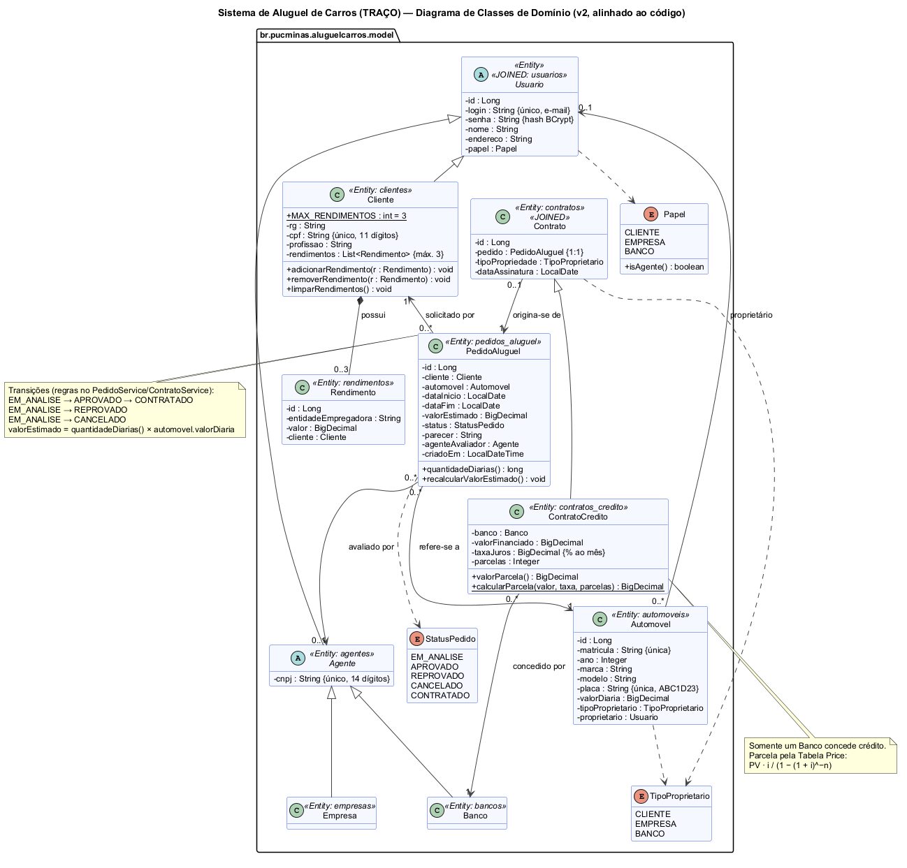</a> | <a href="docs/diagramas/v2/pacotes.png">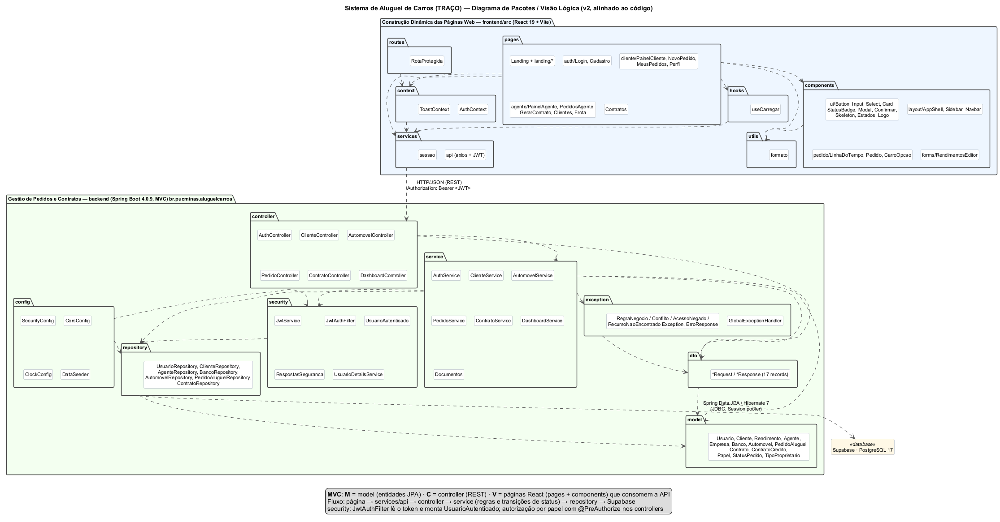</a> |
| **Diagrama de Casos de Uso** | **Histórias de Usuário** |
| <a href="docs/diagramas/v2/casos-de-uso.png">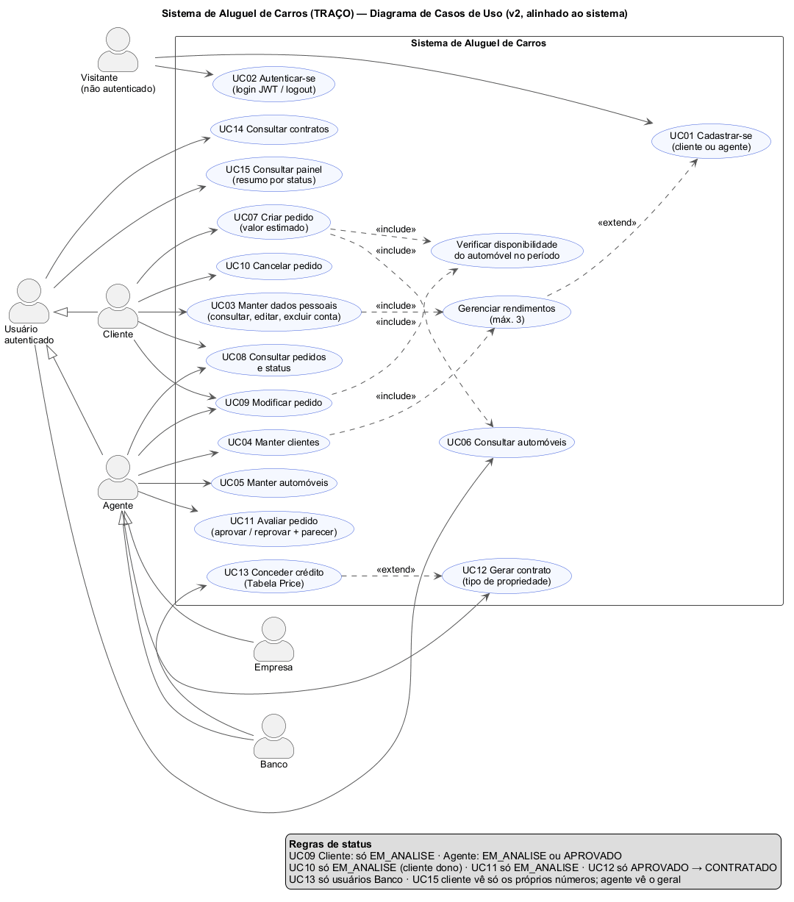</a> | 20 histórias (US01–US20) com critérios de aceitação e matriz história × caso de uso: [`historias-de-usuario.md`](docs/historias/historias-de-usuario.md) |

Fontes PlantUML (`.puml`) e imagens (`.png`) em [`docs/diagramas/v2/`](docs/diagramas/v2/). A modelagem inicial está preservada em [`docs/diagramas/v1/`](docs/diagramas/v1/).

### Evolução dos modelos (v1 → v2)

Principais mudanças (detalhes e justificativas em [`CHANGELOG-MODELOS.md`](docs/diagramas/CHANGELOG-MODELOS.md)):
* `Automovel.valorDiaria` foi adicionado para calcular `PedidoAluguel.valorEstimado`.
* As transições de status saíram das entidades (`modificar`, `cancelar`, `avaliarPedido`, `concederCredito`) e foram para a **camada de serviço**.
* `ContratoCredito.valorParcela()` passou a usar a Tabela Price.
* O diagrama de pacotes passou a listar as classes reais, incluindo `security`, `config`, `exception`, `routes`, `hooks` e `utils`.
* Novos casos de uso: **Consultar painel** e **Verificar disponibilidade do automóvel**.

---

## 🔧 Instalação e Execução

### Pré-requisitos

* **Java JDK 25** (ex.: [Eclipse Temurin](https://adoptium.net/temurin/releases/?version=25)). O Maven Wrapper já vem no projeto.
* **Node.js 20+** e **npm**.
* Uma conta no **[Supabase](https://supabase.com)** com um projeto PostgreSQL criado.

---

### 🔑 Variáveis de Ambiente

#### 1 Back-end (Spring Boot)

Copie `backend/.env.example` para **`backend/.env`**. O arquivo é lido por `spring.config.import` e **não é versionado**.

| Variável | Descrição | Exemplo |
| :--- | :--- | :--- |
| `DB_URL` | URL JDBC do **Session pooler** do Supabase (*Connect → JDBC → Session pooler*) | `jdbc:postgresql://aws-0-us-east-2.pooler.supabase.com:5432/postgres?sslmode=require` |
| `DB_USER` | Usuário do pooler (`postgres.` + ref do projeto) | `postgres.abcdefghijklmn` |
| `DB_PASSWORD` | Senha do banco definida ao criar o projeto | `sua-senha` |
| `JWT_SECRET` | Texto aleatório com **32+ caracteres** para assinar os tokens | `uma-frase-longa-e-aleatoria-com-mais-de-32-caracteres` |
| `JWT_EXPIRACAO_MS` *(opcional)* | Validade do token em ms | `86400000` (24 h) |
| `CORS_ORIGENS` *(opcional)* | Origens liberadas no CORS | `http://localhost:5173` |

> [!IMPORTANT]
> Use o **Session pooler** (IPv4). A conexão *Direct* (`db.<ref>.supabase.co`) só tem IPv6 e costuma falhar em redes domésticas e universitárias. Se aparecer `tenant/user not found`, troque `aws-0` por `aws-1` no host (ou vice-versa).

#### 2 Front-end (React, Vite)

Opcional. Sem o arquivo, o front usa `http://localhost:8080`.

| Variável | Descrição | Exemplo |
| :--- | :--- | :--- |
| `VITE_API_URL` | Endereço do back-end (sem `/api`) | `http://localhost:8080` |

```bash
cp frontend/.env.example frontend/.env
```

---

### 📦 Instalação de Dependências

```bash
git clone https://github.com/engsoftmarcelo/lab02-aluguel-carros.git
cd lab02-aluguel-carros
```

#### Front-end (React)

```bash
cd frontend
npm install
cd ..
```

#### Back-end (Spring Boot)

```bash
cd backend
./mvnw clean install -DskipTests   # Windows: mvnw.cmd clean install -DskipTests
cd ..
```

---

### 💾 Banco de Dados (Supabase)

Não há script manual. Na primeira execução:
1. o Hibernate cria as tabelas (`ddl-auto=update`): `usuarios`, `clientes`, `agentes`, `empresas`, `bancos`, `rendimentos`, `automoveis`, `pedidos_aluguel`, `contratos` e `contratos_credito`;
2. o `DataSeeder` popula o banco vazio com as [contas de demonstração](#-contas-de-demonstração) e 6 automóveis.

> [!TIP]
> Ative o **RLS** (Row Level Security) nas tabelas pelo painel do Supabase. O back-end conecta como dono das tabelas e não é afetado, e a API pública do Supabase fica bloqueada.

---

### ⚡ Como Executar a Aplicação

#### Terminal 1: Back-end (Spring Boot)

```bash
cd backend
./mvnw spring-boot:run   # Windows: mvnw.cmd spring-boot:run
```
🚀 *A API estará em **http://localhost:8080/api**.*

#### Terminal 2: Front-end (React, Vite)

```bash
cd frontend
npm run dev
```
🎨 *O site estará em **http://localhost:5173**.*

---

### 👥 Contas de Demonstração

Criadas automaticamente pelo `DataSeeder` (dados de teste):

| Papel | Login | Senha |
|---|---|---|
| Cliente | `cliente@demo.com` | `demo123` |
| Empresa (agente) | `empresa@demo.com` | `demo123` |
| Banco (agente) | `banco@demo.com` | `demo123` |

Na tela de login, o bloco **"Contas demo"** preenche essas credenciais com um clique.

---

## 🚀 Build para Produção

```bash
# Front-end: gera arquivos estáticos em frontend/dist
cd frontend && npm run build

# Back-end: gera o JAR executável em backend/target
cd ../backend && ./mvnw clean package

# Execução
java -jar target/aluguel-carros-0.0.1-SNAPSHOT.jar
```

Em produção, defina `DB_URL`, `DB_USER`, `DB_PASSWORD`, `JWT_SECRET` e `CORS_ORIGENS` (com a URL do front) no provedor, e `VITE_API_URL` no build do front.

---

## 🔌 Endpoints da API

Base: `http://localhost:8080/api` · Autenticação: `Authorization: Bearer <token>` (exceto login e cadastro).

| Método | Rota | Acesso | Descrição |
|---|---|---|---|
| POST | `/auth/registro/cliente` | público | Cadastra cliente (até 3 rendimentos) e devolve o token |
| POST | `/auth/registro/agente` | público | Cadastra agente (`EMPRESA` ou `BANCO`) |
| POST | `/auth/login` | público | `{login, senha}` → `{token, expiraEm, usuario}` |
| GET | `/auth/me` | autenticado | Dados do usuário logado |
| GET · POST | `/clientes` | agente | Lista/busca (`?busca=`) e cadastra clientes |
| GET · PUT · DELETE | `/clientes/me` | cliente | Próprio cadastro |
| GET · PUT · DELETE | `/clientes/{id}` | agente ou o próprio | Cliente por id |
| POST · PUT · DELETE | `/clientes/{id}/rendimentos[/{rid}]` | agente ou o próprio | Rendimentos (422 no 4º) |
| GET | `/automoveis` · `/automoveis/{id}` | autenticado | Frota (`?busca=`) |
| POST · PUT · DELETE | `/automoveis[/{id}]` | agente | Manter frota |
| POST | `/pedidos` | cliente | Cria pedido (`EM_ANALISE`) |
| GET | `/pedidos/meus` | cliente | Pedidos do cliente |
| GET | `/pedidos?status=` | agente | Fila de pedidos |
| GET · PUT | `/pedidos/{id}` | dono ou agente | Detalhe / modificar |
| PATCH | `/pedidos/{id}/cancelar` | cliente dono | → `CANCELADO` |
| PATCH | `/pedidos/{id}/avaliar` | agente | `{aprovado, parecer}` → `APROVADO`/`REPROVADO` |
| POST | `/pedidos/{id}/contrato` | agente | `{tipoPropriedade, credito?}` → `CONTRATADO` (crédito só para banco) |
| GET | `/contratos` · `/contratos/meus` · `/contratos/{id}` | agente / cliente | Contratos |
| GET | `/dashboard/resumo` | autenticado | Contadores por status (geral para o agente, próprios para o cliente) |

Erros sempre no formato `{timestamp, status, erro, mensagem, caminho, campos?}`. Exemplo de saída:

```bash
curl http://localhost:8080/api/dashboard/resumo -H "Authorization: Bearer <token-do-agente>"
```
```json
{
  "escopo": "GERAL",
  "pedidosPorStatus": { "EM_ANALISE": 0, "APROVADO": 0, "REPROVADO": 1, "CANCELADO": 2, "CONTRATADO": 4 },
  "totalPedidos": 7,
  "totalContratos": 4,
  "valorContratado": 5238.1,
  "contratosComCredito": 3,
  "valorFinanciado": 4188.4,
  "totalClientes": 4,
  "totalAutomoveis": 6
}
```

---

## 📂 Estrutura de Pastas

```
.
├── .gitignore                    # 🧹 Ignora .env, node_modules, target, dist, mídia bruta
├── README.md                     # 📘 Este documento
│
├── /backend                      # ☕ Subsistema "Gestão de Pedidos e Contratos" (Spring Boot 4, MVC)
│   ├── .env.example              # 🧩 Variáveis do back-end (sem valores sensíveis)
│   ├── mvnw / mvnw.cmd / pom.xml # 🛠️ Maven Wrapper e dependências
│   ├── /src/main/java/br/pucminas/aluguelcarros
│   │   ├── /controller           # 🎮 Endpoints REST (Auth, Cliente, Automovel, Pedido, Contrato, Dashboard)
│   │   ├── /service              # ⚙️ Regras de negócio e transições de status
│   │   ├── /repository           # 🗄️ Spring Data JPA
│   │   ├── /model                # 🧬 Entidades JPA e enums
│   │   ├── /dto                  # ✉️ Requests/Responses (records)
│   │   ├── /security             # 🛡️ JWT, filtro, usuário autenticado
│   │   ├── /config               # 🔧 Security, CORS, relógio, DataSeeder
│   │   └── /exception            # 💥 Exceções de negócio + GlobalExceptionHandler
│   ├── /src/main/resources       # ⚙️ application.properties
│   └── /src/test/java            # 🧪 Testes JUnit 5 + Mockito (PedidoService, ContratoService)
│
├── /frontend                     # ⚛️ Subsistema "Construção Dinâmica das Páginas Web" (React + Vite)
│   ├── .env.example              # 🧩 VITE_API_URL
│   ├── /public                   # 📂 favicon, /frames (quadros WebP), /img, /media
│   └── /src
│       ├── /pages                # 📄 landing/, auth/, cliente/, agente/, Contratos
│       ├── /components           # 🧱 ui/, layout/, pedido/, forms/
│       ├── /context              # 🔐 AuthContext, ToastContext
│       ├── /hooks                # 🎣 useCarregar
│       ├── /routes               # 🚦 RotaProtegida (por papel)
│       ├── /services             # 🔌 api.js (axios + JWT), sessao.js
│       ├── /styles               # 🎨 tokens, base, ui, shell, auth, app, landing
│       └── /utils                # 🛠️ formato (moeda, datas, máscaras, Tabela Price)
│
└── /docs
    ├── /historias                # 📝 Histórias de usuário
    ├── /diagramas/v1             # 📐 Modelagem inicial (.puml + .png)
    ├── /diagramas/v2             # 📐 Modelagem final alinhada ao código (.puml + .png)
    ├── /diagramas/CHANGELOG-MODELOS.md
    └── /screenshots              # 🖼️ Capturas usadas neste README
```

---

## 🎥 Demonstração

### 🌐 Aplicação Web

| Tela | Captura de Tela |
| :---: | :---: |
| **Landing: o carro gira com o scroll** | **Landing: wireframe vira carro** |
|  |  |
| **Login (com contas de demonstração)** | **Cadastro (cliente ou agente, até 3 rendimentos)** |
| 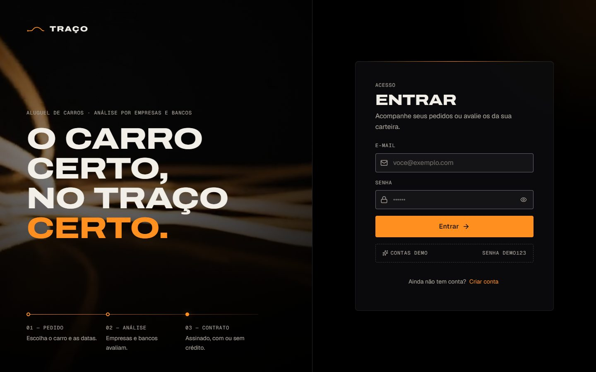 | 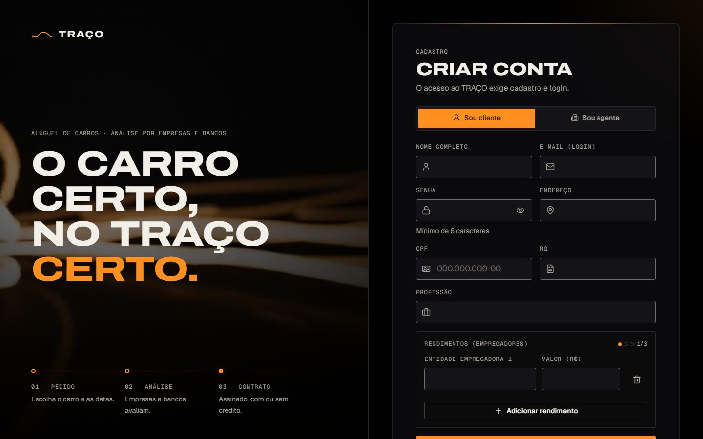 |
| **Painel do cliente** | **Novo pedido (wizard em 3 etapas)** |
| 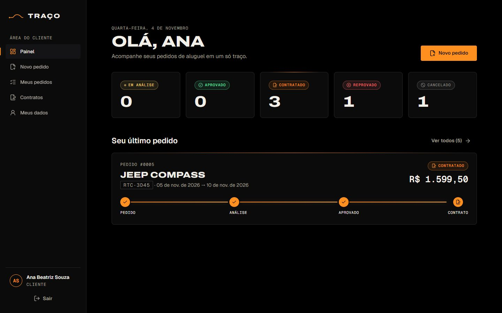 | 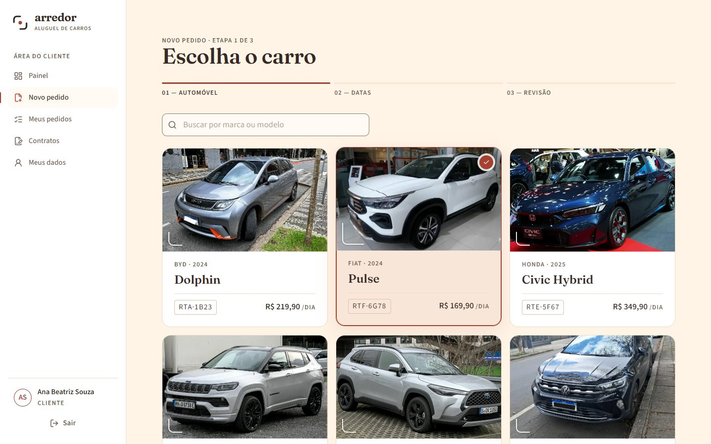 |
| **Detalhe do pedido (linha do tempo)** | **Painel do agente (gráfico por status)** |
| 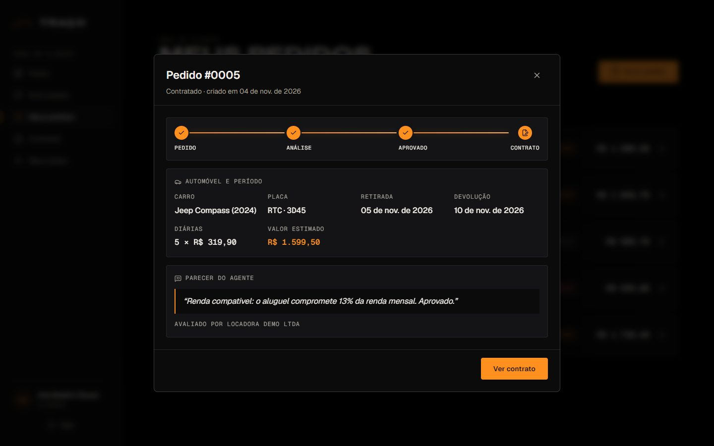 | 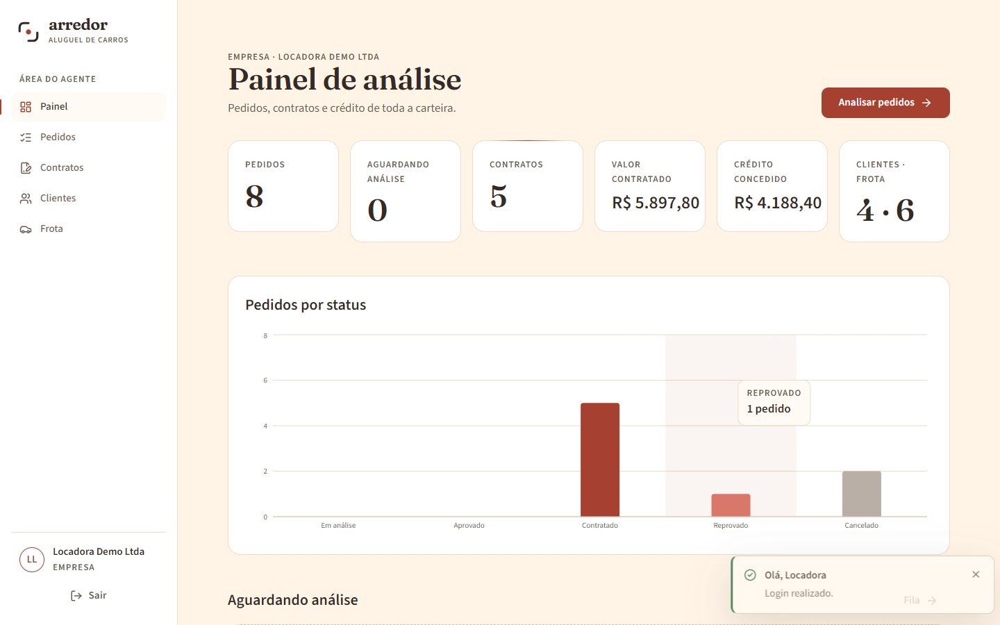 |
| **Análise do pedido (perfil financeiro + parecer)** | **Contratos (com crédito bancário)** |
| 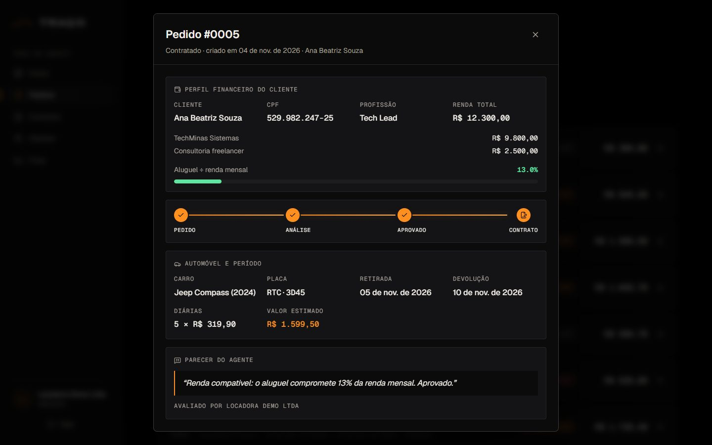 | 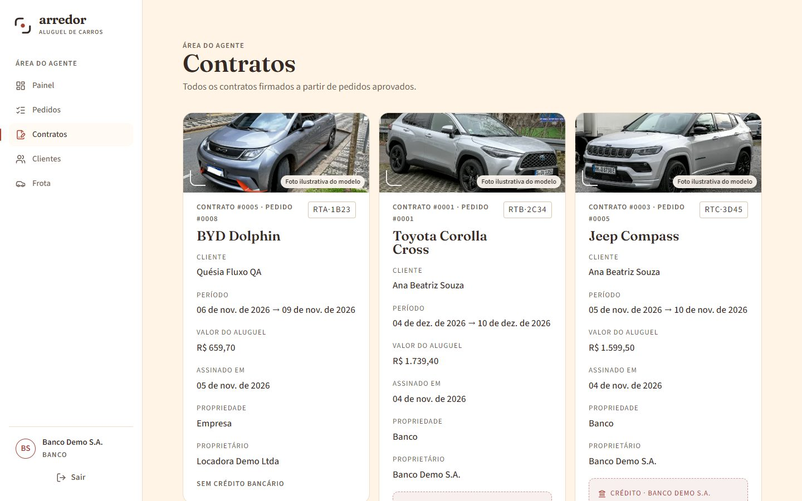 |
| **Mobile: landing** | **Mobile: painel** |
|  |  |

---

## 🧪 Testes

### Testes Unitários (back-end)

```bash
cd backend
./mvnw test
```
**34 testes, 0 falhas.** Cobrem as regras de status do `PedidoService` (criar, cancelar, modificar e avaliar em cada status, datas inválidas e conflito de período) e do `ContratoService` (só pedidos aprovados, crédito só de banco, troca do proprietário, Tabela Price), além da subida completa do contexto Spring contra o banco.
*Ferramentas: JUnit 5, Mockito, AssertJ (relógio fixo injetado via `Clock`).*

### Testes de API (ponta a ponta)

O fluxo completo foi validado com curl (47 cenários) e pelo navegador: cadastro de cliente com 3 rendimentos → pedido → modificação → cancelamento → aprovação pela empresa com parecer → contrato com crédito pelo banco → cliente vê `CONTRATADO`. Também foram verificadas as transições proibidas (422) e as permissões (401/403).

### QA visual e de acessibilidade

Capturas com Playwright + axe-core em 360, 768 e 1440 px, antes e depois das correções, com revisão independente. Resultado: **0 violações de acessibilidade, 0 erros de console, sem rolagem horizontal**.

---

## 🔗 Documentações utilizadas

* 📖 **Back-end:** [Spring Boot](https://docs.spring.io/spring-boot/index.html) · [Spring Security](https://docs.spring.io/spring-security/reference/) · [Spring Data JPA](https://docs.spring.io/spring-data/jpa/reference/)
* 📖 **Banco:** [Supabase — conexão com o banco (pooler)](https://supabase.com/docs/guides/database/connecting-to-postgres) · [Row Level Security](https://supabase.com/docs/guides/database/postgres/row-level-security)
* 📖 **Front-end:** [React](https://react.dev/reference/react) · [Vite](https://vite.dev/config/) · [React Router](https://reactrouter.com/)
* 📖 **Animação:** [GSAP ScrollTrigger](https://gsap.com/docs/v3/Plugins/ScrollTrigger/) · [Lenis](https://github.com/darkroomengineering/lenis) · [Framer Motion](https://motion.dev/)
* 📖 **Modelagem:** [PlantUML](https://plantuml.com/)
* 📖 **Commits:** [Conventional Commits](https://www.conventionalcommits.org/pt-br/v1.0.0/)

---

## 🖼️ Créditos das Mídias

* **Imagens e vídeos** (carro conceito, wireframe, interior, farol, perfil na chuva e rastros de luz): **gerados com Google Flow (Veo/Imagen)** a partir de prompts próprios. O carro é um **conceito sem marca** e não representa nenhum fabricante. Não foram usadas imagens de bancos como Pexels ou Unsplash.
* **Fontes:** Archivo, Geist e Geist Mono (SIL Open Font License 1.1).
* **Ícones:** [lucide](https://lucide.dev) (ISC).
* **Logo TRAÇO:** criado para este projeto (SVG).

---

## 👥 Autores

| 👤 Nome | 🖼️ Foto | :octocat: GitHub | 📤 Gmail |
|---------|----------|-----------------|-----------|
| Marcelo | <div align="center"></div> | <div align="center"><a href="https://github.com/engsoftmarcelo"></a></div> | <div align="center"><a href="mailto:engsoftmarcelo@gmail.com"></a></div> |

---

## 🙏 Agradecimentos

* [**Engenharia de Software PUC Minas**](https://www.instagram.com/engsoftwarepucminas/) — pelo apoio institucional e pela estrutura acadêmica.
* [**Prof. Dr. João Paulo Aramuni**](https://github.com/joaopauloaramuni) — pelo enunciado do LAB02, pelo template deste README e pelos ensinamentos sobre **Arquitetura de Software**, **Spring Boot** e **modelagem UML**.

---

## 📄 Licença

Projeto acadêmico desenvolvido para a disciplina DIAW (PUC Minas). Uso educacional.

---
